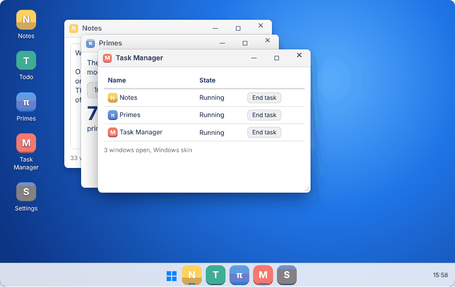
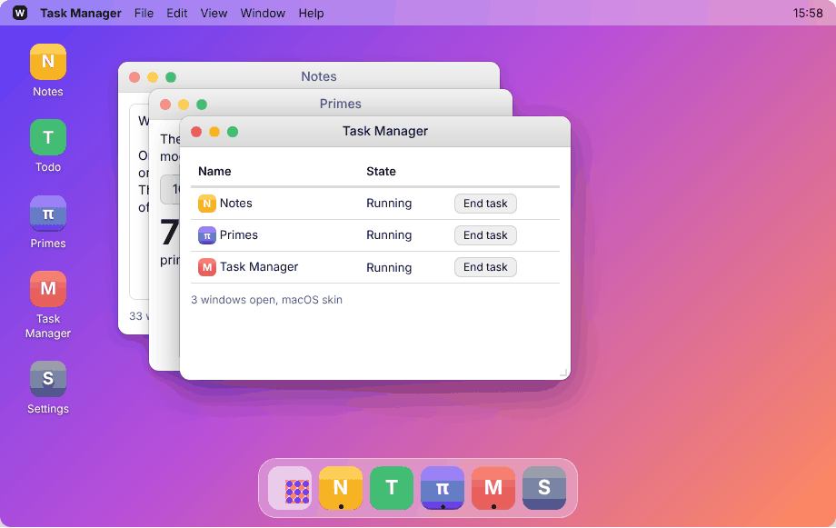
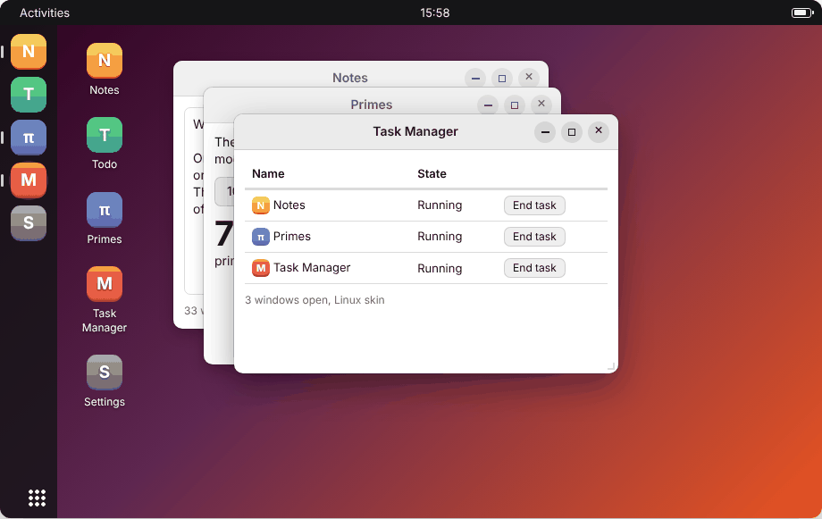
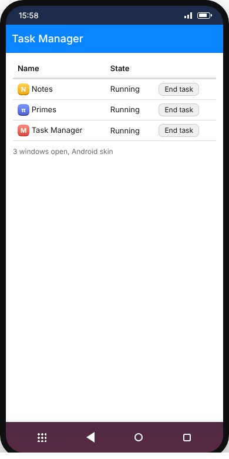

# fsharp-wasm-embedded

<!-- status -->
[](https://github.com/fsharp-wasm/fsharp-wasm-embedded/actions/workflows/ci.yml) · [Status of every repository](https://fsharp-wasm.github.io/status/)
<!-- /status -->

<!-- platform -->
> **Part of the [fsharp-wasm platform](https://fsharp-wasm.github.io/projects/)**: hosts. Builds on [runtime](https://github.com/fsharp-wasm/fsharp-wasm-runtime) and [mobile](https://github.com/fsharp-wasm/fsharp-wasm-mobile). Status: **planned; the device probe and the WasmOS demo exist**.
> [All projects](https://fsharp-wasm.github.io/projects/) · [Roadmap](https://fsharp-wasm.github.io/docs/roadmap/) · [Tests](https://fsharp-wasm.github.io/tests/) · [Benchmarks](https://fsharp-wasm.github.io/benchmarks/) · [Live demos](https://fsharp-wasm.github.io/demos/)

The **universal shell** of the platform: one F# application, compiled to WebAssembly GC, runs as a native app on the desktop (Windows, macOS, Linux) and on a phone or tablet (iOS, Android),
with a window, an icon, a store listing, offline start-up and the device behind a bridge. The application stays what it is today: a `.wasm` module and web assets (the
[runtime](https://github.com/fsharp-wasm/fsharp-wasm-runtime) and everything built on it). The shell is the part that is not a web page.

**This repository is a plan with one working piece, not yet a shell.** No host is built. What exists is the page that answers the first question of the whole undertaking: *can the web view of
this device run our modules at all?*

## The probe

[`probe/index.html`](probe/index.html) is one file without dependencies. Open it on a device (serve the folder, or copy the file) and it checks:

- **the engine**: WebAssembly GC, tail calls, exception handling and the JS string builtins, the four things every module the compiler emits needs (checked on the 14 modules of the
  [runtime](https://github.com/fsharp-wasm/fsharp-wasm-runtime) site, 2026-11-24);
- **the web APIs** the runtime uses and the [device APIs](https://github.com/fsharp-wasm/fsharp-wasm-mobile) fall back on: module workers, Canvas 2D, WebGL 2, WebGPU, IndexedDB, share, vibration, wake lock, geolocation, camera, Bluetooth, Gamepad and more;
- **the device**: screen, pixel ratio, safe-area insets, pointer and hover, colour gamut and HDR, cores, memory.

It ends with a verdict and a report you can copy. **Sending one in is a contribution that needs no code**: open a
[device report](https://github.com/fsharp-wasm/fsharp-wasm-embedded/issues/new?template=device_report.yml) with the report. The table of what is known goes here as reports arrive.

| Device | OS | Web view | Engine (GC, tail calls, exceptions, js-string) | Reported |
|---|---|---|---|---|
| a container, headless | Linux | Chromium 153 | all four | 2026-11-24, probe 1 (the test) |

## WasmOS: the same application in the chrome of each system

[`demos/wasmos`](demos/wasmos) is a small desktop in F# — windows you drag, resize and minimise, a launcher, five apps — that is **Windows, macOS, Android or a Linux desktop** from one program: the model is a
pure function (tested under .NET), the module states the DOM and the class of the screen, and a stylesheet makes each system look as it does. It shows what the shell is for, before there is a shell. Live in the
[runtime's demos](https://fsharp-wasm.github.io/fsharp-wasm-runtime/demos/wasmos/) once the site is deployed; `node tests/e2e/wasmos.mjs` in the runtime drives it (46 checks).

| Windows | macOS |
|---|---|
|  |  |
| **Linux** | **Android** |
|  |  |

## How it is meant to fit

```text
the application   Counter.wasm + web assets + app.json           what the author writes and builds
        │ runs in
the shell         this repository: window, lifecycle, packaging, bridge, permissions
        │ hosts
the device APIs   fsharp-wasm-mobile: typed F# modules, JS glue with web fallbacks, native plugins
        │ on
a web view        WebView2 · WKWebView · WebKitGTK · Android System WebView
```

Proposals, not decisions: [docs/architecture.md](docs/architecture.md) (the manifest, the bridge, the permission model, the targets) and
[docs/decisions/0001-shell-base.md](docs/decisions/0001-shell-base.md) (build on an existing shell, or write thin hosts: what to measure before choosing).

## Where it goes

1. **The matrix** (now): the probe, and a table of devices from reports.
2. **A spike**: one existing demo (the accounting grid or WasmOS) in a shell on Linux, macOS and Windows; measured: size of the app, start-up, what the web view of each OS runs.
3. **The bridge and the manifest**, with the first device APIs from [fsharp-wasm-mobile](https://github.com/fsharp-wasm/fsharp-wasm-mobile).
4. **iOS and Android.**
5. **Packaging, signing, updates.**
6. Television targets come later and live with the device APIs.

Every number here is measured and dated, and what is not measured says so.

## Contributing

Run the probe on a device you have and file a [device report](https://github.com/fsharp-wasm/fsharp-wasm-embedded/issues/new?template=device_report.yml); add a check to the probe (it is one file and
a test); read the proposals in `docs/` and say what is wrong with them. [CONTRIBUTING](https://github.com/fsharp-wasm/.github/blob/develop/CONTRIBUTING.md) is the organisation's;
[AGENTS.md](AGENTS.md) says how the platform is worked on. `npm ci && npm test` runs the probe in Chromium.

## License

[Apache-2.0](LICENSE).
